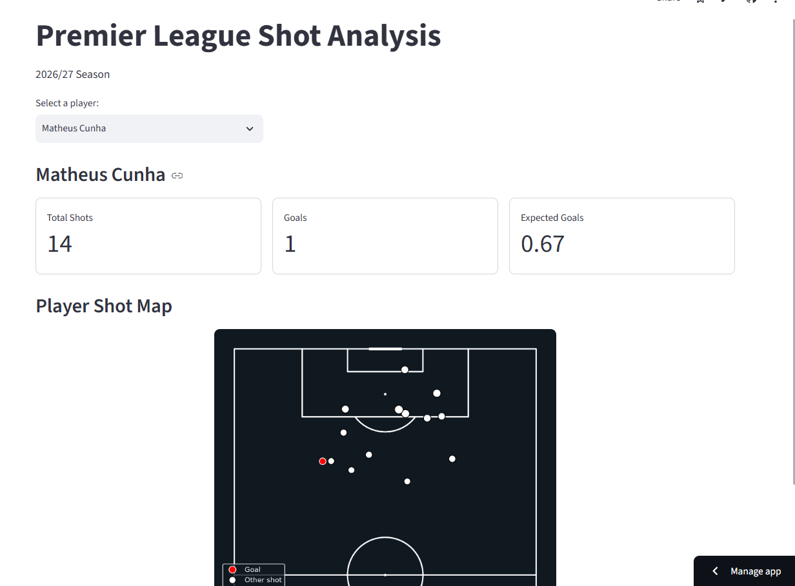
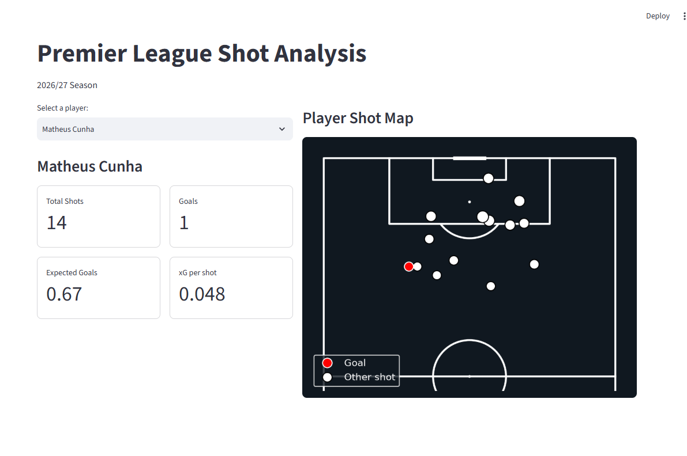
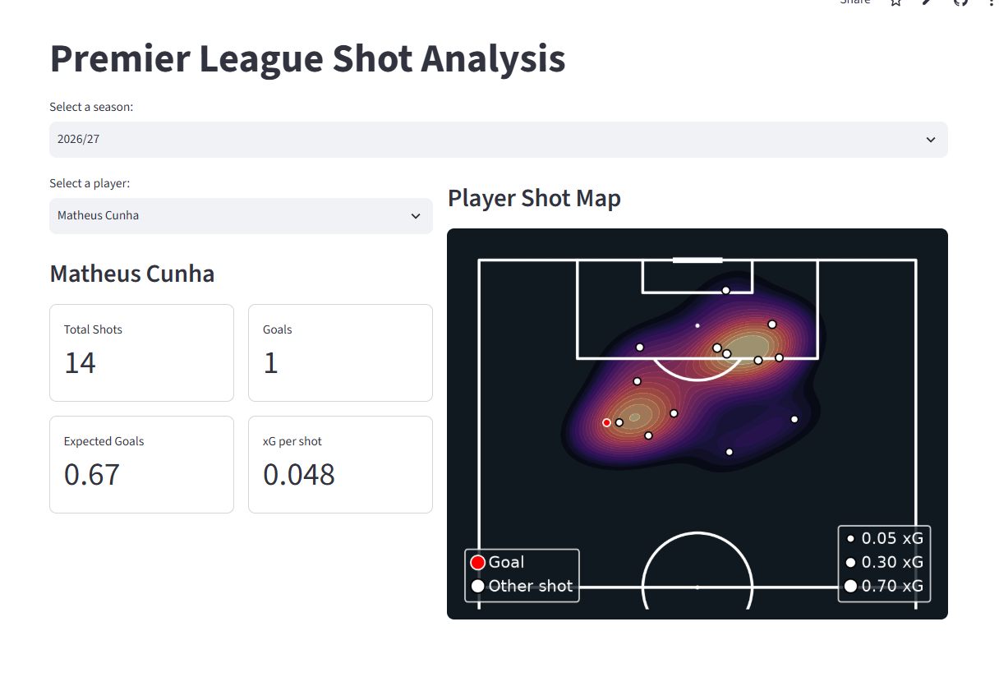
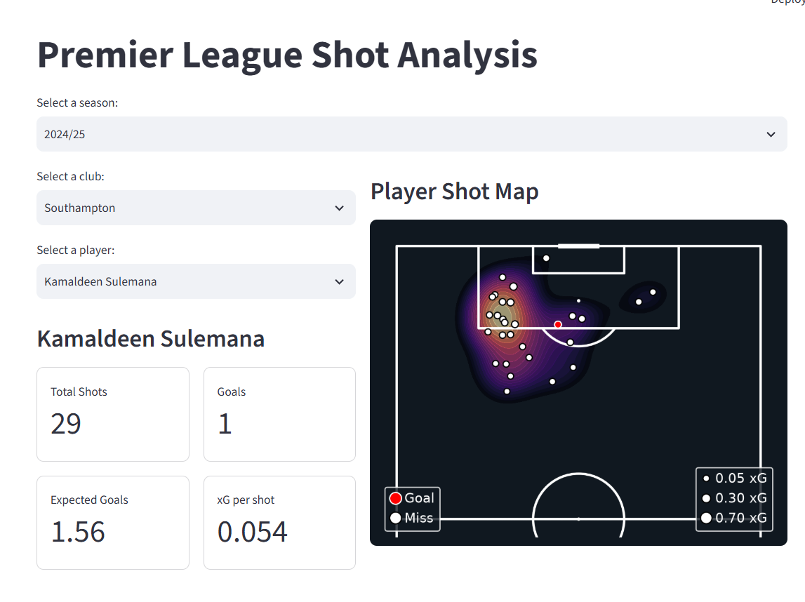
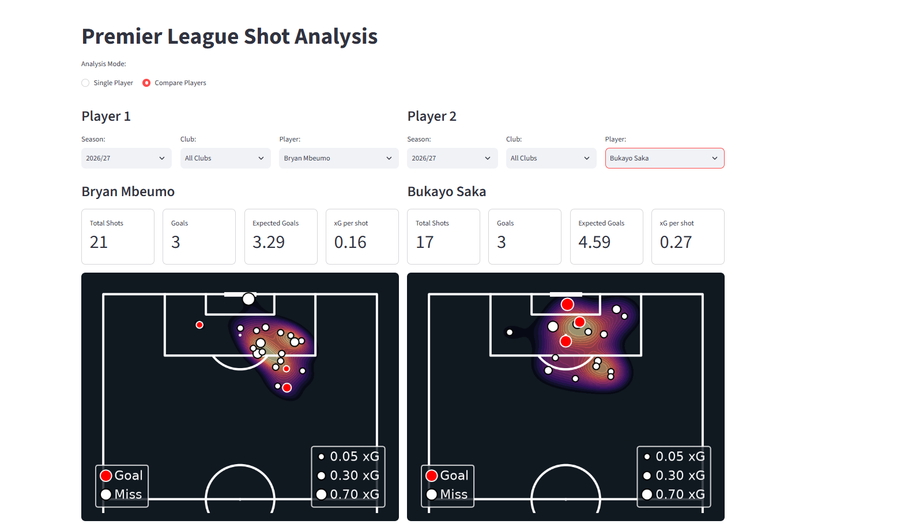
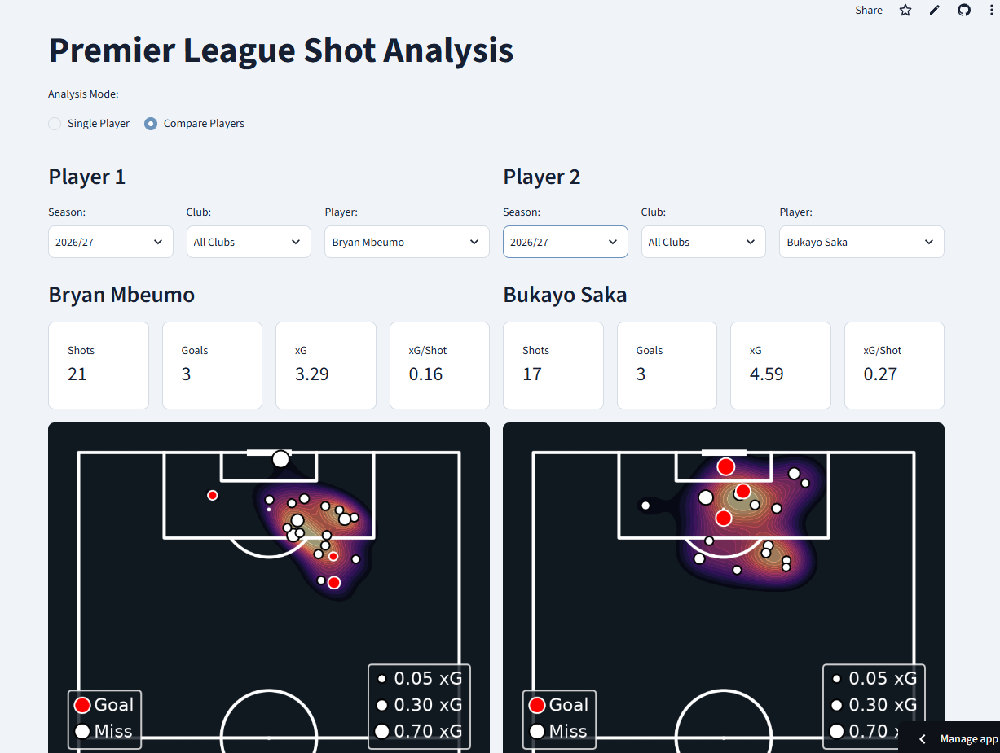

## Dashboard Preview

Initial dashboard

Altered dashboard, adding left_panel and right_panel commands, with a new statistic, xG per shot, added

New legend added for xG in bottom right, xG circle size scaled down to represent scale of chance more accurately

Added shot-density heat map (subject to optimisation), using the pitch.kdeplot() from the mplsoccer libary. Also added option to choose a season, from the 22/23 season

Added club choice option

Added player comparison

Optimised layout

